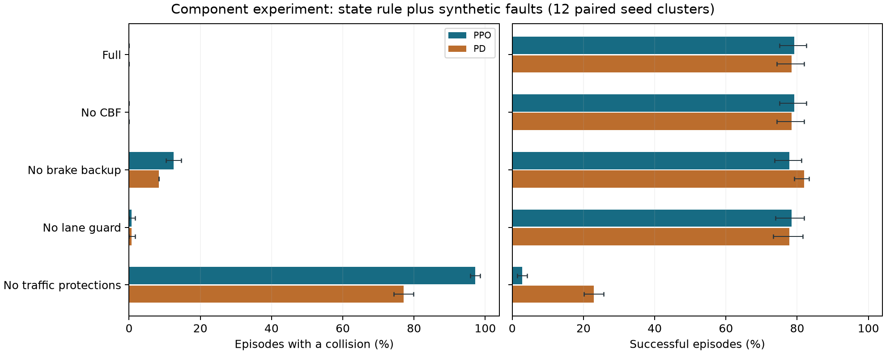

# What the components actually contribute

Physical MetaDrive experiment completed November 11, 2026. All 4,608 frozen cells retained; 192 disjoint pilot cells excluded from main results.

## Direct answer

With frozen PPO, all three traffic protections recorded 0/288 collision episodes and 228/288 successes. Removing all three recorded 280/288 collisions and 8/288 successes. Common road-boundary and numerical-validity checks remain in both groups.

The complete diagnostic mix includes a state rule and deliberately faulty routers, not a measured real-world error distribution. A crash-free drive below the 99% route threshold is still a failure. The frozen route-success metric can count an episode that reaches 99% at timeout; timeout and safety-abort counts are reported separately. Individual contributions below distinguish overlapping protections from unique benefits.

## All factorial cells

C = longitudinal CBF constraint; B = stopping-envelope backup; G = lane-change admission guard. All cells share road containment, finite checks and the validity monitor. Achieved lateral jerk RMS is m/s^3, measured from actual physical acceleration; episodes can differ in crash/timeout exposure.

| Controller / CBF / brake / lane guard | n | Crashes | Successes | Mean route | Achieved jerk RMS |
|---|---:|---:|---:|---:|---:|
| pd / C0B0G0 | 288 | 222 | 66 | 52.46% | 2.70 |
| pd / C0B0G1 | 288 | 226 | 62 | 52.95% | 2.16 |
| pd / C0B1G0 | 288 | 2 | 224 | 89.69% | 3.51 |
| pd / C0B1G1 | 288 | 0 | 226 | 89.96% | 3.41 |
| pd / C1B0G0 | 288 | 46 | 216 | 84.35% | 3.59 |
| pd / C1B0G1 | 288 | 24 | 236 | 90.19% | 2.94 |
| pd / C1B1G0 | 288 | 2 | 224 | 89.69% | 3.61 |
| pd / C1B1G1 | 288 | 0 | 226 | 89.96% | 3.51 |
| ppo / C0B0G0 | 288 | 280 | 8 | 42.24% | 0.74 |
| ppo / C0B0G1 | 288 | 286 | 2 | 41.35% | 0.50 |
| ppo / C0B1G0 | 288 | 2 | 226 | 89.67% | 4.03 |
| ppo / C0B1G1 | 288 | 0 | 228 | 89.97% | 3.91 |
| ppo / C1B0G0 | 288 | 42 | 211 | 85.09% | 3.50 |
| ppo / C1B0G1 | 288 | 36 | 224 | 87.94% | 3.12 |
| ppo / C1B1G0 | 288 | 2 | 226 | 89.67% | 3.35 |
| ppo / C1B1G1 | 288 | 0 | 228 | 89.97% | 3.22 |

## Conditional removal from the full PPO system

Differences below are component ON minus OFF. Negative collision differences are beneficial; positive success differences are beneficial. These conditional effects can be small when another protection provides overlapping coverage.

- cbf_given_full_ppo: crashed: +0.00 percentage points (95% seed-cluster interval +0.00 to +0.00); success: +0.00 percentage points (95% seed-cluster interval +0.00 to +0.00).
- braking_given_full_ppo: crashed: -12.50 percentage points (95% seed-cluster interval -14.58 to -10.42); success: +1.39 percentage points (95% seed-cluster interval -4.86 to +6.94).
- admission_given_full_ppo: crashed: -0.69 percentage points (95% seed-cluster interval -1.74 to +0.00); success: +0.69 percentage points (95% seed-cluster interval +0.00 to +1.74).
- ppo_vs_pd_given_full: crashed: +0.00 percentage points (95% seed-cluster interval +0.00 to +0.00); success: +0.69 percentage points (95% seed-cluster interval +0.00 to +2.08).

## Main factorial effects

Each effect averages the ON-minus-OFF paired difference over the other component settings, all scenes, both injected delays and all three diagnostic routers. PPO-minus-PD is conditional on these particular checkpoints and fixed gains. Pairwise interactions in statistics.json are raw differences of differences: (both on - first off/second on) - (first on/second off - both off), averaged over other factors. They are not half-scaled DOE coefficients. Every metric is retained.

- controller: collision difference +5.47 points (95% interval +4.56 to +6.34).
- cbf: collision difference -37.59 points (95% interval -38.28 to -36.85).
- braking: collision difference -50.09 points (95% interval -51.35 to -48.87).
- admission: collision difference -1.13 points (95% interval -1.69 to -0.56).

## Evidence and limits

- Twelve paired traffic seeds, four scene families, two delays and three rule/fault policies. Geometry is a supported straight road; this does not establish curved-road or real-vehicle safety.
- The state rule implements explicit lane/occupancy semantics. Front-blind removes vehicles at relative x <=8 m; copy-current repeats the current maneuver. Neither is the teammate's actual VLM or an estimated VLM error distribution.
- Both controllers have zero critic and pending inflation, the same fixed 2 Hz query policy and blending. Calls may be delayed by pending responses and blending; trajectories and subsequent requests are allowed to diverge. This is a closed-loop component-policy comparison, not identical action replay.
- Cluster bootstrap resamples 12 seeds jointly across all conditions (10,000 draws). This is exploratory, without multiplicity correction or independent policy training. Zero observed events are not zero population risk; nonsignificance is not equivalence.
- Correction counts describe stages, not unique causal contribution. CBF counts can include actuator clipping; braking corrections are incremental after CBF. The factorial contrasts supply the controlled contribution estimates.
- Validity monitor changed actions on 0 ticks; emergency status appeared on 0 ticks. Its behavior was held identical in all cells.
- Achieved jerk comes from every episode's physical trace. Episode duration includes timeouts and early crashes; neither duration nor jerk alone is a fair performance verdict when safety/progress differ.
- Under full protection, PPO has lower achieved lateral jerk RMS than PD (paired mean difference -0.286 m/s^3), but higher mean peak jerk after warmup (+16.657 m/s^3). Adding CBF with backup/guard present similarly reduces RMS (-0.691) while raising the mean peak (+2.808). These mixed comfort outcomes do not establish uniformly smoother control; exact intervals are in statistics.json.
- The actual camera adapter was exercised with rendered frames, asynchronous control and a loopback HTTP fixture. Its replies are programmed, clearly marked non-model. The teammate's exact source and saved evaluations were subsequently recovered from GitHub commit 1f16b7ff59aae20c2a9adfbeb4943762d4b1f5b4 despite the absent branch. The private Modal checkpoint and a model endpoint remain unavailable, so combined trained-VLM performance is pending. See ACCESS_UPDATE.md and audits/teammate-source-review.md.
- The new camera prompt excludes current-skill text. The teammate v1 model was trained with a different prompt; its reported frame accuracy cannot be inherited by this integration without retesting.

## Reproduce

See ../README.md and ../PROTOCOL.md. Exact source/checkpoint/design locks, raw pilot/test gzip rows, all 24 condition tables and every paired contrast are included. Existing earlier scheduler research is preserved separately and is not relabeled as this experiment.

