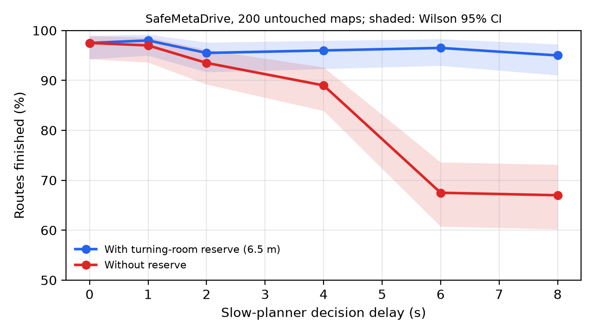

# Paper Results: Frozen Final Evaluation (2026-11-26)

Every number below evaluates **one canonical 3-layer, strictly observation-only system** (`UnifiedDrivingSystem`) on map splits that were never used during development. Rates carry Wilson 95% intervals; mean costs carry bootstrap 95% intervals; paired columns are exact two-sided McNemar tests over identical maps.

## Canonical System Architecture (Zero Simulator Peeking)

1. **Layer 1 — Fast Safety Filter (259-dim LiDAR + ego state):** Stopping-distance speed cap, road-boundary steering guard, fresh lane-admission gate, turning-room reserve (6.5 m), semantic `STOP`/`CAREFUL` enforcement, and a LiDAR crossing-traffic guard (8-frame cluster velocity tracking, ego-motion compensated, yields when a moving vehicle enters the ego corridor within 3 s).
2. **Layer 2 — Fast Controller (12-dim pure-sensor features):** Trained shielded PPO tracker (3 seeds, BC warm-start + 300k PPO inside Layer 1; also compared against pure from-scratch PPO with 0 demos and the analytic formula controller).
3. **Layer 3 — Event-Triggered Slow Router:**
   - **Layer 3a (Geometric Replanner):** Wakes up only when the current lane is blocked.
   - **Layer 3b (Visual VLM Reasoner):** PatchCore visual novelty + LiDAR static-object backup trigger (10–40 m, second look at 20 m) calling `Qwen3-VL-8B-Instruct` with verified hold release (2 consecutive proceed answers with P(proceed) ≥ 0.47).

## Evaluation Protocol

| Split | Maps | Role |
|---|---|---|
| SafeMetaDrive 0–99 | 100 | Training (PPO trackers & RL baselines) |
| SafeMetaDrive 100–149, 500–549, 600–649 | 150 | Development & checkpoint selection |
| Irregular 1000–1049 | 50 × 8 scenes | Development |
| highway-env seeds 100–149 | 50 × 3 envs | Development |
| **SafeMetaDrive 2000–2199** | **200** | **Frozen final test** |
| **Irregular 3000–3099** | **100 × 8 scenes** | **Frozen final test** |
| **highway-env seeds 1000–1199** | **200 × 3 envs** | **Frozen final test** |

---

## Table 1. SafeMetaDrive, 200 Untouched Maps (2000–2199)

All methods see the same 259-float LiDAR + ego-state observation except IDM (privileged simulator object state). "Any-cost episodes" is the fraction of episodes with any safety cost.

| Method | n | Finished | Zero-cost finished | Any-cost episodes | Mean cost [95% CI] | Mean steps | Paired vs Analytic (zero-cost) |
|---|---:|---:|---:|---:|---:|---:|---|
| **Ours (Shielded PPO, seed0)** | 200 | **98.0% [95.0, 99.2]** | **98.0% [95.0, 99.2]** | **1.0% [0.3, 3.6]** | **0.010 [0.000, 0.025]** | 574 | 2 / 4, p=0.688 |
| **Ours (Shielded PPO, seed1)** | 200 | **98.5% [95.7, 99.5]** | **98.0% [95.0, 99.2]** | **1.0% [0.3, 3.6]** | **0.040 [0.000, 0.120]** | 577 | 3 / 5, p=0.727 |
| **Ours (Shielded PPO, seed2)** | 200 | 96.0% [92.3, 98.0] | 95.0% [91.0, 97.3] | 4.5% [2.4, 8.3] | 0.680 [0.025, 1.970] | 564 | 6 / 2, p=0.289 |
| **Ours (From-Scratch PPO, 0 demos, seed0)** | 200 | 85.0% [79.4, 89.3] | 84.5% [78.8, 88.9] | 9.0% [5.8, 13.8] | 0.245 [0.075, 0.525] | 590 | 28 / 3, p=4.65e-06 |
| **Ours (From-Scratch PPO, 0 demos, seed1)** | 200 | 91.5% [86.8, 94.6] | 90.0% [85.1, 93.4] | 3.0% [1.4, 6.4] | 0.090 [0.015, 0.190] | 594 | 20 / 6, p=0.00936 |
| **Ours (From-Scratch PPO, 0 demos, seed2)** | 200 | 91.5% [86.8, 94.6] | 91.5% [86.8, 94.6] | 2.0% [0.8, 5.0] | 0.035 [0.005, 0.085] | 592 | 17 / 6, p=0.0347 |
| **Ours (Analytic formula)** | 200 | **97.5% [94.3, 98.9]** | **97.0% [93.6, 98.6]** | 3.0% [1.4, 6.4] | 0.055 [0.010, 0.125] | 560 | *(Reference)* |
| Ablation: no crossing guard | 200 | 95.5% [91.7, 97.6] | 91.5% [86.8, 94.6] | 8.5% [5.4, 13.2] | 1.910 [0.250, 4.920] | 525 | 14 / 3, p=0.0127 |
| Ablation: no safety filter | 200 | 96.0% [92.3, 98.0] | 83.0% [77.2, 87.6] | 17.0% [12.4, 22.8] | 1.730 [1.030, 2.550] | 501 | 30 / 2, p=2.46e-07 |
| Ablation: no replanning (Layer 3a off) | 200 | 54.0% [47.1, 60.8] | 53.5% [46.6, 60.3] | 3.5% [1.7, 7.0] | 0.050 [0.015, 0.095] | 739 | 88 / 1, p=2.91e-25 |
| Ablation: no steering blending | 200 | 97.5% [94.3, 98.9] | 97.0% [93.6, 98.6] | 3.0% [1.4, 6.4] | 0.050 [0.010, 0.110] | 558 | 1 / 1, p=1 |
| IDM *(privileged simulator objects)* | 200 | 85.0% [79.4, 89.3] | 79.5% [73.4, 84.5] | 20.5% [15.5, 26.6] | 0.990 [0.365, 1.860] | 429 | 37 / 2, p=2.84e-09 |
| PPO-Lag (1M, best budget) seed0 | 200 | 49.0% [42.2, 55.9] | 38.5% [32.0, 45.4] | 61.5% [54.6, 68.0] | 2.140 [1.605, 2.760] | 424 | 119 / 2, p=5.55e-33 |
| PPO-Lag (1M, best budget) seed1 | 200 | 60.5% [53.6, 67.0] | 50.5% [43.6, 57.4] | 49.5% [42.6, 56.4] | 1.655 [1.235, 2.115] | 477 | 97 / 4, p=3.36e-24 |
| PPO-Lag (1M, best budget) seed2 | 200 | 48.5% [41.7, 55.4] | 35.0% [28.7, 41.8] | 65.0% [58.2, 71.3] | 2.220 [1.725, 2.770] | 387 | 126 / 2, p=4.85e-35 |
| CPO (5M, OmniSafe defaults) seed0 | 200 | 31.0% [25.0, 37.7] | 25.0% [19.5, 31.4] | 31.0% [25.0, 37.7] | 22.415 [7.550, 40.615] | 710 | 147 / 3, p=7.88e-40 |
| CPO (5M, OmniSafe defaults) seed1 | 200 | 53.5% [46.6, 60.3] | 43.5% [36.8, 50.4] | 45.0% [38.3, 51.9] | 14.530 [5.375, 26.395] | 506 | 111 / 4, p=3.45e-28 |
| CPO (5M, OmniSafe defaults) seed2 | 200 | 17.5% [12.9, 23.4] | 16.0% [11.6, 21.7] | 48.5% [41.7, 55.4] | 7.515 [0.965, 18.615] | 574 | 167 / 5, p=4.07e-43 |
| MetaDrive PPO-Expert *(unsafe RL ref)* | 200 | 55.0% [48.1, 61.7] | 46.5% [39.7, 53.4] | 45.0% [38.3, 51.9] | 187.370 [141.145, 235.465] | 609 | 102 / 1, p=2.05e-29 |

*Note on RL baseline budgets: For each safe-RL baseline we report its stronger training configuration (1M study config for PPO-Lag; 5M OmniSafe defaults for CPO). The weaker configurations (1M CPO: 0.5–5.5%; 5M PPO-Lag under `cost_limit=1.0`: 2.0–6.0%) are preserved in `reports/final/evidence/safemetadrive-2000-2199.json.gz`.*

**Key Takeaways:**
- **Shielded PPO (BC + 300k PPO inside Layer 1):** 3-seed average **97.5% finished / 97.0% zero-cost / 2.2% any-cost**, matching Analytic (`p = 0.29–0.73`), with 2 of 3 seeds reaching **98.0–98.5% finished and 1.0% any-cost** (3× fewer safety violations than Analytic).
- **Pure From-Scratch PPO (0 demos, CleanRL defaults, 1M steps):** Reaches **89.3% finished / 88.7% zero-cost / 4.7% any-cost** (up to **91.5% / 2.0% any-cost**) from random weights — beating privileged IDM (`79.5%` zero-cost, `20.5%` any-cost) and nearly doubling unshielded 5M CPO (`43.5%` best seed) and 1M PPO-Lag (`50.5%` best seed).
- **Every active Layer 1 / 3a component matters:** Removing the safety filter raises any-cost episodes `3.0% → 17.0%` (`p = 2.5e-7`); removing the crossing guard raises them to `8.5%` (`p = 0.013`); removing Layer 3a replanning drops completion `97.5% → 54.0%` (`p = 2.9e-25`). Steering blending has no measurable effect (`p = 1`).

---

## Figure 1 & Table 2. Slow-Planner Delay vs. Turning-Room Reserve (Same 200 Maps)

| Delay | Finished, reserve 6.5 m | Finished, no reserve | Paired (reserve-only / no-reserve-only), p |
|---:|---:|---:|---|
| 0 s | 97.5% | 97.5% | 0 / 0, p=1 |
| 1 s | 98.0% | 97.0% | 3 / 1, p=0.62 |
| 2 s | 95.5% | 93.5% | 9 / 5, p=0.42 |
| 4 s | 96.0% | 89.0% | 19 / 5, p=0.0066 |
| 6 s | 96.5% | 67.5% | 60 / 2, p=8.5e-16 |
| 8 s | 95.0% | 67.0% | 57 / 1, p=4.1e-16 |

**Reading:** Below 4 s, the turning-room reserve makes no significant difference. At 4 s it becomes statistically significant (`p = 0.0066`), and at 6–8 s it separates **95.0–96.5%** completion from **67.0–67.5%** (`p < 1e-15`) on random untouched maps.

---

## Table 3. Irregular Visual Scenes (`3000–3099`, 100 Untouched Maps × 8 Scenes)

Every arm uses the same Layers 1–2 (LiDAR safety filter + crossing guard, analytic tracker) on the
same 100 untouched maps × 8 scenes (800 episodes per arm). Only Layer 3 differs. The VLM arm is
v3 frozen at commit `68dd2b2` (Qwen3-VL-8B, PatchCore + LiDAR backup trigger, verified hold release),
run once on 2026-11-26. "Violation" = any collision, or passing the flagger while it shows STOP.
"Needless stop" = stopped > 3 s near an object that does not require stopping. "Deadlock" = never
got past the flagger within the step budget. Paired column: exact McNemar test on violations over
identical (scene, map) pairs, VLM vs that arm.

| Arm | Violations | Flagger STOP passed | Needless stops | Flagger deadlocks | Route % | Slow calls/ep | Paired violations (only-VLM-safe / only-arm-safe) |
|---|---:|---:|---:|---:|---:|---:|---|
| **Ours + Qwen3-VL-8B** | **2.9% [1.9, 4.3]** | **18/100** | **1.4% [0.8, 2.4]** | 13/100 | 29.0 | 7.3 | – |
| Normal (no VLM) | 14.1% [11.9, 16.7] | 99/100 | 0.9% [0.4, 1.8] | 0/100 | 30.7 | 0 | 93 / 3, p=3.7e-24 |
| Always careful (no VLM) | 12.8% [10.6, 15.2] | 98/100 | 1.0% [0.5, 2.0] | 0/100 | 28.7 | 0 | 82 / 3, p=5.3e-21 |
| LiDAR → careful (no VLM) | 12.9% [10.7, 15.4] | 98/100 | 0.8% [0.3, 1.6] | 0/100 | 30.1 | 3.2 | 83 / 3, p=2.7e-21 |
| LiDAR → stop (no VLM) | 0.2% [0.1, 0.9] | 0/100 | 35.1% [31.9, 38.5] | 100/100 | 14.6 | 14.7 | 1 / 22, p=5.7e-06 |
| Oracle (ground-truth label) | 0.8% [0.3, 1.6] | 0/100 | 0.9% [0.4, 1.8] | 0/100 | 28.4 | 5.9 | 4 / 21, p=0.00091 |

Per scene (violations · needless stops · route %):

| Scene | VLM | Normal | Careful | Oracle | LiDAR → careful | LiDAR → stop |
|---|---:|---:|---:|---:|---:|---:|
| Flagger | 18/100 · 0 · 23% | 99/100 · 0 · 25% | 98/100 · 0 · 25% | 0/100 · 0 · 25% | 98/100 · 0 · 25% | 0/100 · 0 · 9% |
| Wet road closure | 2/100 · 0 · 16% | 8/100 · 0 · 17% | 2/100 · 0 · 16% | 1/100 · 0 · 17% | 1/100 · 0 · 17% | 0/100 · 0 · 12% |
| Pedestrian in lane | 0/100 · 0 · 24% | 0/100 · 0 · 25% | 0/100 · 0 · 25% | 0/100 · 0 · 9% | 0/100 · 0 · 25% | 0/100 · 0 · 9% |
| Lane-closed sign | 0/100 · 3 · 25% | 2/100 · 2 · 25% | 0/100 · 3 · 25% | 0/100 · 2 · 25% | 0/100 · 2 · 25% | 0/100 · 93 · 9% |
| Billboard | 0/100 · 3 · 25% | 2/100 · 2 · 25% | 0/100 · 2 · 25% | 2/100 · 2 · 25% | 0/100 · 1 · 25% | 0/100 · 93 · 8% |
| Pedestrian on shoulder | 0/100 · 5 · 25% | 0/100 · 3 · 25% | 0/100 · 3 · 25% | 0/100 · 3 · 25% | 0/100 · 3 · 25% | 0/100 · 95 · 10% |
| Rain, no obstacle | 1/100 · 0 · 43% | 1/100 · 0 · 52% | 1/100 · 0 · 44% | 2/100 · 0 · 49% | 2/100 · 0 · 49% | 1/100 · 0 · 30% |
| Clean road | 2/100 · 0 · 50% | 1/100 · 0 · 52% | 1/100 · 0 · 44% | 1/100 · 0 · 52% | 2/100 · 0 · 49% | 1/100 · 0 · 30% |

Route % is partial by design: object scenes end shortly after the object is passed or at the step limit.

**Reading.** Without the VLM, every arm that can move on also drives past the STOP sign (98–99/100),
because nothing in the LiDAR picture says what the sign reads. The only no-VLM arm that obeys it,
LiDAR → stop, does so by freezing at every object: 35% needless stops and a deadlock on all 100
flagger maps. The VLM arm obeys STOP on 82/100 maps (it waits a median 17 s and then goes once the sign
turns to SLOW on 69/100), with needless stops at the level of the no-VLM arms (1.4% vs 0.8–1.0%).
Overall violations fall from 12.8–14.1% to 2.9% (p < 1e-20 against every arm that keeps moving). The
gap to the ground-truth oracle (0.8%) is 18 STOP misreads plus 13 deadlocks where the release never
accepted "proceed". The VLM costs 7.3 slow calls per episode, 2.8 of them on the clean road (LiDAR
backup trigger on roadside objects).

**Model choice.** An offline check on development frames compared Qwen3-VL-8B with Qwen3-VL-30B-A3B
and Qwen3-VL-32B ([vlm-screen.md](irregular/vlm-screen.md)). Neither larger model reads the STOP sign
better at 15–25 m (8B 82%, 32B 61%, 30B-A3B 33%), so the 8B was kept.

---

## Table 4. Cross-Simulator Transfer: `highway-env` (200 Fresh Seeds × 3 Environments)

Same observation (`Kinematics`, 10 vehicles) for every method; 10 Hz control; 1.5 s slow-planner delay; ego-heading frame rotation; same constant-velocity crossing guard.

| Method | highway-v0 | merge-v1 | roundabout-v1 | Overall crash-free | Calls/ep | Paired vs ours |
|---|---:|---:|---:|---:|---:|---|
| **Ours (event + filter + guard + reserve)** | 80.5% [74.5, 85.4] | 100.0% [98.1, 100.0] | 67.5% [60.7, 73.6] | **82.7% [79.4, 85.5]** | **3.7** | – |
| Event + filter + guard, no reserve | 79.0% [72.8, 84.1] | 100.0% [98.1, 100.0] | 68.0% [61.2, 74.1] | 82.3% [79.1, 85.2] | 3.8 | 19 / 17, p=0.87 |
| Ours without crossing guard | 79.5% [73.4, 84.5] | 100.0% [98.1, 100.0] | 50.5% [43.6, 57.4] | 76.7% [73.1, 79.9] | 2.9 | 53 / 17, p=2e-5 |
| Always-ask 10 Hz **with** same filter | 79.5% [73.4, 84.5] | 100.0% [98.1, 100.0] | 63.0% [56.1, 69.4] | 80.8% [77.5, 83.8] | 210.7 | 43 / 32, p=0.25 |
| Static safety filter (no replanning) | 74.0% [67.5, 79.6] | 83.0% [77.2, 87.6] | 71.0% [64.4, 76.8] | 76.0% [72.4, 79.2] | 0.0 | 82 / 42, p=4e-4 |
| Unshielded fast driver | 10.0% [6.6, 14.9] | 99.0% [96.4, 99.7] | 58.0% [51.1, 64.6] | 55.7% [51.7, 59.6] | 0.0 | 193 / 31, p=9e-30 |
| Always-ask 10 Hz, no filter | 4.5% [2.4, 8.3] | 39.5% [33.0, 46.4] | 57.5% [50.6, 64.1] | 33.8% [30.2, 37.7] | 129.4 | 321 / 28, p=3e-64 |

**Reading:** The architecture transfers cleanly (`55.7%` unshielded / `76.0%` static filter → `82.7%`). The event trigger's win is **compute cost (57× fewer calls)**, not safety over a fair shielded always-ask (`p = 0.25`). The crossing guard lifts `roundabout-v1` from `50.5% → 67.5%` (`p = 2e-5`). At 1.5 s delay the reserve has no measurable effect, matching Figure 1.

---

## Table 5. Real-World Sensor Replays (Waymo + nuScenes, 13 Scenes): Transfer Check Only

| Method | Crash-free (13 scenes) |
|---|---:|
| LiDAR safety filter + tracker | 76.9% [49.7, 91.8] |
| Unshielded tracker | 61.5% [35.5, 82.3] |
| Constant throttle | 30.8% [12.7, 57.6] |

*With 13 scenes the confidence intervals overlap; this is a qualitative real-sensor transfer check, not a statistical claim.*

---

## Limitations

- **Simulated perception:** The VLM sees MetaDrive camera renders with synthetic props and weather.
- **VLM release threshold:** The hold-release threshold (`P(proceed) ≥ 0.47`) operates in a narrow band and may need recalibration for a different VLM.
- **Remaining edge cases:** ~1–2% of SafeMetaDrive maps still end off-road on tight outer-lane roundabout entries.
- **VLM residual errors:** On the final maps the VLM still passes the flagger's STOP sign on 18/100 maps (first-look misreads) and deadlocks on 13/100 (the release never accepts "proceed").
- **Table 3 tracker:** The irregular scenes use the analytic Layer 2 tracker for every arm; the shielded PPO tracker of Table 1 was not run there.
