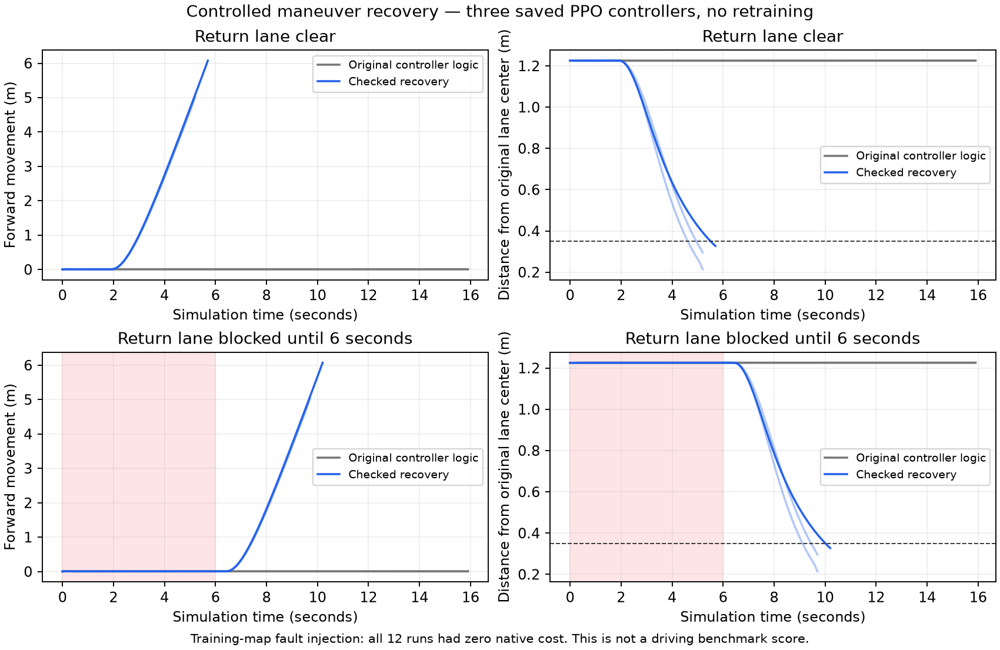

# Local maneuver recovery implementation

The new maneuver mode can recover from the controlled “stopped halfway through a lane change” failure without retraining. All three saved PPO controllers returned to their original lane and resumed in the physics fixtures. When that return lane was blocked, each controller waited until it cleared. All twelve fixture runs, including original-logic controls, had zero native cost. **This validates the recovery mechanism in those fixtures; it is not a new camera-driving benchmark score.**

No Modal jobs, camera inference or training were launched. Simulation was restricted to training map 0 for controlled fault injection and development maps 100–149 for saved-input diagnostics. The original final-test results and model weights were preserved.

The implementation adds an explicit `manage_maneuvers=True` mode in [LaneCautionDriver](../driving/safemetadrive/policies.py) and the camera evaluator. The existing behavior remains the default, so historical comparisons are not silently switched to a new controller. The new behavior is implemented in [maneuvers.py](../driving/safemetadrive/maneuvers.py).

Before committing a lane change, the new mode checks current gaps, route continuity near lane endings and the sampled transition forecast. This check includes vehicles approaching from behind. The existing emergency-braking forecast intentionally ignores rear followers; reusing that behavior for lane entry would miss a different hazard. The forecast still assumes constant object velocities and a simplified ego path over three seconds; it is a heuristic screen, not a proof that the entire maneuver is feasible.

An admitted change is tracked as executing, blocked, returning or completed. Completion requires being within 0.35 m of the target lane center and within 0.15 radians of its heading. A new lane change cannot interrupt an unfinished one. Repeated stay/caution messages do not reset the progress watchdog.

If progress stays below 0.5 m for two seconds while speed is below 0.5 m/s, an unfinished maneuver is marked blocked. The supervisor may return only to that maneuver's original source lane, using the same gap/route checks and the transition forecast. It does not select an unrelated lane or disable a collision stop. During a return, the cruise target is capped at 2 m/s and careful mode is retained. The abandoned target receives a five-second retry cooldown. A return that becomes blocked does not oscillate between targets. Automatic recovery is disabled if collision protection or forecasting is disabled.

If the source lane is occupied or unsafe under the forecast, the car continues to hold and periodically reassesses it. This does not guarantee that a safe escape exists. Road transitions invalidate the stored source-lane context. A centered car stopped behind an obstacle is not treated as an unfinished lane change; ordinary planning must still decide how to pass it.

The camera interface now optionally reports maneuver state, time without position progress, the previous instruction's rejection reason, whether caution was applied and a recovery hold reason. A fresh request for more caution can be applied even when its lane change is rejected; a rejected normal-speed request cannot remove caution. Stale and expired commands still cannot change the target. This new feedback prompt has not been tested with live camera inference. Teacher queries explicitly avoid advancing the live supervisor through their shallow copy.

The physical fixtures create a deliberately blocked maneuver on training map 0 with traffic/accident generation disabled. A lane change is admitted while the scene is clear, then the car is placed 35% through that transition at standstill and a physical cone is introduced ahead in the target lane. In one condition the source lane is clear. In the other, a second cone blocks the source lane until six seconds. Each condition is run with original and managed logic for each of the three saved PPO trackers, giving 12 runs. This is fault injection with altered initial conditions, not the native benchmark configuration.

| Fixture condition | Original logic, three PPO replicas | Managed logic, three PPO replicas |
|---|---|---|
| Return lane clear | All remained essentially stationary | All returned and completed the maneuver |
| Return lane blocked until 6 s | All remained essentially stationary | All waited, then returned after 6 s |
| Native cost | Zero in all six controls | Zero in all six managed runs |

With the return lane clear, the checked return began at controller time 2.1 s and completed at 5.2–5.8 s. With it blocked, the return began at 6.6 s and completed at 9.7–10.3 s. Every managed run advanced more than 5 m with final distance from its original lane center below0.35m. The original logic advanced less than 0.01 m over the fixture. These are simulation/controller times, not inference or wall-clock performance measurements.



The final code also ran 42 fixed-input development diagnostics: seven selected development maps × three trained controller replicas × original/managed logic. These replay camera letters and measured response times from the older balanced-training development runs, not the final 92%-success camera model; no new images are classified. Once the car takes a different path, the saved letters no longer correspond to its current views. Consequently, these runs exercise controller behavior under matched instruction streams and cannot measure the changed camera system's closed-loop performance.

| Final-code fixed-input checks | Original | Managed |
|---|---:|---:|
| Destination completions / 21 | 10 | 13 |
| Summed native cost | 11 | 0 |
| Automatic returns | 0 | 0 |

Five paired cases completed only with the new mode; two completed only with the original. These cases were chosen from known development difficulties and controls, so this is not an unbiased generalization estimate. No automatic aborts were needed in these particular streams: the differences concern admission, maneuver sequencing and caution handling. The fault-injection fixtures establish the separate recovery behavior. Three original-logic replay endpoints differed from their historical cloud reports, illustrating numerical/runtime sensitivity; comparisons in this table use both variants in the same current local runtime.

An earlier candidate also completed 300 diagnostics covering all 50 development maps and three controllers, with each stream run under both modes. It recorded 127 versus 130 completions and total cost 15 versus 4. Its two source files differ from the final code: final transition checks include rear-approaching traffic and recovery requires active protection. The preliminary outputs and exact hash-matched versions of those files are retained separately; they are not presented as validation of the final code on all 150 streams. The initial five-map pilot and21-pair stress run are also retained under local `runs/safemetadrive/`.

Validation passed **271 repository tests**, including 14 new maneuver tests and two real MetaDrive physics regressions. Tests cover blocked returns, no target oscillation, retained braking during recovery, stale caution, route-ending rejection, fast rear-approaching traffic and teacher-query side effects. Mypy passed for 15 SafeMetaDrive/tool files; lint passed for the changed files. The final physics fixtures and 42 fixed-input diagnostics have source hashes matching the final driving code. Frozen-model weights and the original benchmark artifacts were not edited.

The remaining uncertainty is explicit: live camera response to feedback, performance with fresh camera inference, collision behavior outside these fixtures, and progress in scenes without a checked return path remain unverified. A new held-out benchmark score requires new inference and evaluation, and was not run. No Modal spending is required to inspect or reproduce the local mechanism checks.

Evidence: [verification](safemetadrive-maneuver-recovery/verification.json), [physical trajectories](safemetadrive-maneuver-recovery/physics-fixtures.json), [final-code development diagnostics](safemetadrive-maneuver-recovery/recorded-intent-final.json), and [preliminary diagnostics](safemetadrive-maneuver-recovery/recorded-intent-preliminary.json).

Reproduce the physics check locally with an existing tracker:

```bash
CUDA_VISIBLE_DEVICES='' .venv/bin/python tools/safemetadrive_maneuver_fixture.py \
  --checkpoint runs/safemetadrive/heldout-study-v1/artifacts/skills-1m-v1/skills-seed0/ppo.zip \
  --output runs/safemetadrive/recovery-check.json
```

The [development diagnostic tool](../tools/safemetadrive_maneuver_check.py) rejects maps outside 100–149. Both tools force CPU execution and never call Modal or run the camera model. Native-camera evaluation can explicitly enable `manage_maneuvers=True` in `evaluate_camera`; it remains an opt-in experiment requiring fresh evaluation.
